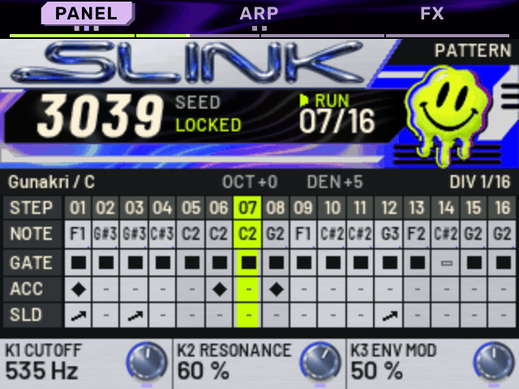
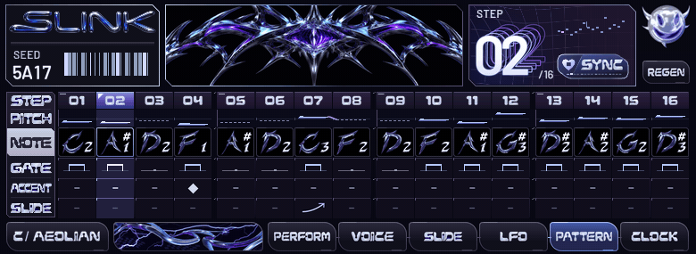
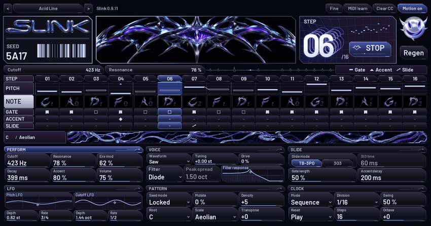

# hdslave Slink Synthesizer

**A 303-style acid bass synthesizer driven by a tick-accurate port of Ornament & Crime's TB-3PO generative sequencer, for the Akai MPC Sample, freesp16 on SP-16, macOS and Windows.**

<table>
  <tr>
    <th width="26%">MPC Sample</th>
    <th width="26%">SP-16 · freesp16</th>
    <th width="48%">macOS and Windows · CLAP</th>
  </tr>
  <tr>
    <td align="center"><a href="docs/slink-screen.webp"></a></td>
    <td align="center"><a href="docs/slink-sp16.webp"></a></td>
    <td align="center"><a href="docs/slink-desktop-0.9.11.webp"></a></td>
  </tr>
</table>

[See all six freesp16 pages](docs/screen.md#thorn-crown-on-freesp16) · [Watch the freesp16 panel in motion](docs/slink-sp16.webp) · [See all five silver MPC pages](docs/screen.md#silver-panel-on-mpc) · [View Blacklight Transfer](docs/slink-mpc-blacklight.png)

## hdslave plug-in license

You may use these plug-ins to make, perform, record and sell music, including paid client work, without royalties or credit to hdslave. You may share complete, unchanged official releases for free with their notices intact. Selling the software, including it in a paid product or subscription, or distributing a modified version requires prior written permission from hdslave. Third-party components keep their own licenses. [Full plug-in license](LICENSE.txt).

## Downloads

| Platform | Packaged build |
| --- | --- |
| MPC Sample with hdslaveOS or Melodee | [Slink 0.9.0 for MPC Sample](https://github.com/hdslave/hdslave-Slink-Synth/releases/download/v0.9.0/Slink-0.9.0-MPC-Sample.zip) |
| SP-16 with freesp16 | [Slink 0.9.11 for freesp16](https://github.com/hdslave/hdslave-Slink-Synth/releases/download/v0.9.11/Slink-0.9.11-freesp16.zip) |
| macOS, Apple Silicon and Intel | [Slink 0.9.11 for macOS](https://github.com/hdslave/hdslave-Slink-Synth/releases/download/v0.9.11/Slink-0.9.11-macOS-universal.zip) |
| Windows x64 | [Slink 0.9.11 for Windows](https://github.com/hdslave/hdslave-Slink-Synth/releases/download/v0.9.11/Slink-0.9.11-Windows-x64.zip) |

[0.9.11 release notes and checksums](https://github.com/hdslave/hdslave-Slink-Synth/releases/tag/v0.9.11) · [Build the freesp16 panel](#freesp16-on-sp-16)

The desktop gallery shows Slink **0.9.11** playing Acid Line. The desktop transport has a heart and a step indicator. The framed whip animation lines up with the scale readout below the score. All 34 controls fit in the same window. [Full-resolution desktop still](docs/slink-desktop-0.9.11.png) · [Watch 20 seconds with audio](https://github.com/hdslave/hdslave-Slink-Synth/blob/desktop-v0.9.11/mac-clap/assets/slink-desktop-playback.mp4?raw=1) · [Desktop 0.9.11 source and controls](https://github.com/hdslave/hdslave-Slink-Synth/tree/desktop-v0.9.11/mac-clap)

Built for the Akai MPC Sample running [Melodee](https://github.com/keremimo/melodee-sample) / [hdslaveOS](https://github.com/hdslave/hdslaveOS) (64-bit ARM Linux, Cortex-A55); it runs in any Linux `arm64` CLAP host. Hosts list this MPC build as **hdslave Slink** (id `com.hdslave.tb-mpc-3-p-0`, version 0.9.0).

On hdslaveOS 0.8.3, select **Stage → Panel** to open Slink’s custom screen. Edit opens the host parameter list. On hdslaveOS 0.7.1, the custom screen also opens directly in Edit. Both use the `melodee.screen/1` extension. An MPC instance that has never received a screen callback uses 413,832 fewer bytes than in 0.5.3. It creates the page on first use.

TB-3PO's pattern generator, RNG, quantizer, and step/gate/accent/slide logic are ported line-for-line from Ornament & Crime's Hemisphere firmware (as in the Benisphere Suite): the same seed, density, and scale produce the exact same acid line as on the Eurorack module, verified tick-by-tick in the test suite (see [Tests](#tests)). The host transport drives clock and reset; the pads play the pattern's steps one at a time, on any bank an octave apart (see [MIDI notes and pads](#midi-notes-and-pads)). Under **hdslaveOS**, its **Press Plate** screen displays every step's note, gate, accent, and slide — with a **Blacklight Transfer** theme one press away (see [The screen](#the-screen)).

## Signal flow

```
host transport ──clock (Clock Div)──► TB-3PO ──pitch CV (with its slide)──► VCO (saw or square)
               ──reset (Reset)─────►        ──gate (3 V; 5 V = accent)──► MEG, VEG, accent
Transpose knob ──transpose (as CV 1)───►
pad (any key: (key - 36) mod 16) ──its step, once: the step's pitch (an octave per bank) and gate──► the voice (the play head stays)

VCO ──► Filter: Diode ladder / Twin Peak / 18 dB (cutoff: Cutoff, Env Mod x MEG, accent sweep)
    ──► VCA (VEG + accent) ──► Drive ──► Volume ──► out
```

On the MPC it draws its own page on the screen (see [The screen](#the-screen)).

Not yet run on the MPC itself: tested in hdslaveOS's own CLAP host code (`clap_check`) and this repository's tests.
The drum map and bank rule of 0.9.0 (see [MIDI notes and pads](#midi-notes-and-pads)) are untested on the device too.

## Controls

In the order Melodee's Edit page lists them, three to a page.

### The voice (the 303's panel)

| Control | Range | What it does |
|---|---|---|
| Tuning | ±12 semitones | The VCO's pitch. 0 V from the sequencer is C2 (65.4 Hz). |
| Cutoff | 7 octaves | The filter's cutoff before the envelope and accent open it, calibrated as the 303's service notes set the 303's: at its middle, with Resonance full, the resonant peak is at 500 Hz, in each filter. It reads what you hear (see [Filter](#filter)), so its text moves with Resonance and Filter. |
| Resonance | 0 – 100 % | The filter's feedback: the 303's and Twin Peak's up to just short of self-oscillation, 18 dB's into it at the top (from 86 %); the passband thins (about -6 dB) as on a 303. It also slows the accent sweep. |
| Env Mod | 0 – 100 % | How far the MEG opens the filter (up to 4.5 octaves) and how far it lowers the cutoff's floor (up to 1.3 octaves), as on the 303. |
| Decay | 200 ms – 2 s | The MEG's decay (to -40 dB). An accented step takes Accent Decay's (by default the shortest, as on the 303), slid into or not; a plain step takes this one, even slid into from an accent. |
| Accent | 0 – 100 % | How much an accented step (TB-3PO's 5 V gate) lifts the VCA (up to +7 dB) and opens the filter through the accent sweep. Accents in a row at high resonance build up. |
| Waveform | Saw / Square | |
| Volume | 0 – 100 % | |
| Slide | TB-3PO / 303 | **TB-3PO** uses the applet’s tick-based slide. **303** glides in both directions and uses Slide Time. |
| Slide Time | 15 – 600 ms | — (new): the 303 glide's time to arrive (95 %), for **303** slides and glides in **Notes** mode. 60 ms (a time constant of 20 ms) is the 303's and the default. The applet's slide keeps its own speed. |
| Accent Decay | 200 ms – 2 s | — (new): the MEG's decay on an accented step. Its default, the shortest, is the 303's, whose accented steps always take it; longer lets an accent's sweep hang. |
| Drive | 0 – 100 % | — (new): after the VCA, a soft clipper driven up to +30 dB, anti-aliased (first-order antiderivative). Its level is made up so a playing pattern stays within about -2 to +3 dB of the dry voice; a held, dark note (few harmonics of its own) still grows louder as it gains them, up to about +12 dB. 0 is no drive at all. |
| Filter | Diode / Twin Peak / 18 dB | — (new): see [Filter](#filter). |
| Peak Spread | 0.5 – 4 octaves | — (new): Twin Peak's upper peak, this far over the lower (Cutoff's). |

The VCA's own envelope is fixed, as on the 303: it opens in 1 ms, decays slowly while the gate is held and closes
in a few ms when the gate shuts.

### Sine LFOs

**TONE** has a pitch LFO for vibrato. **Amount** sets the depth from zero to ±2 semitones. At the bottom of
**VOICE**, a separate LFO sweeps filter cutoff by up to ±3 octaves. In VOICE, Tuning sits directly above Volume.

Each **Speed** knob goes from four beats per cycle to an eighth of a beat per cycle and follows the host BPM.
Virtual detents lock the cycle to **1/1**, **3/4**, **1/2**, or **1/3** of a beat, with continuous speeds in between.
Both LFOs run when playing notes with transport stopped. Each Amount starts at zero.

While the song plays they keep to its place: a Play or a jump sets them on it, and so does the place drifting more
than 0.0025 of a quarter from their own count (MTC's speed trim adds up; before 0.8.2 they drifted off the song
without limit, about a sixth of a cycle by beat 32 at 1 cycle a beat). Told a place behind their count (a plug-in two
tracks play is run twice a block), they hold until the song is past it, so they still go round once a beat of the song.

### Filter

- **Diode**: the 303's 4-pole diode ladder (as before). Its stages are coupled, so with Resonance at 0 its passband
  ends at about a ninth of its nominal frequency (an octave or so of 6 dB/octave slope first); from about 10 %
  Resonance on, the feedback flattens it out close to the resonant peak. Its range is 38 Hz – 4.9 kHz nominal: the
  top where it was before the calibration, more room at the bottom. (The presets kept their sound: their Cutoff
  moved to where the same filter now sits. So do projects saved by 0.1 - 0.3: their Cutoff is moved as they load. A
  host's automation of Cutoff recorded before 0.4 is not, and plays about an octave darker.)
- **Twin Peak**: two 4-pole transistor-style ladders on the same input, each with its own feedback and clip, the
  lower subtracted from the upper, after Rob Hordijk's TwinPeak arrangement. Below both they cancel; between them the
  band passes, a resonant peak at each edge (Cutoff the lower, Peak Spread the upper); above, 24 dB/octave. At the
  very top the lower peak stops half an octave under the upper's ceiling, so the band never closes. Vowel-like
  with resonance, thin in the bass by design. About as loud as the 303 filter (-1.6 dB on the tests' pattern).
- **18 dB**: three equal stages in a loop, the 18 dB/octave ladder of acid filters such as Doepfer's A-103. Brighter
  than the diode ladder with Resonance low, and it self-oscillates at the top of Resonance (from 86 %), at about
  the peak's pitch.

Each filter is cleared once the VCA has closed, so a gate after silence starts it clean, however long the note before
it was held. (Before 0.8.1, after a gate held until its filter envelope had died away, about 1.3 s at the default
Decay, as a long note in Mode: Notes or a long slid gate, the next attack began on the old note's filter state and
differed from a clean start by up to 0.15 for its first 7 – 20 ms.)

Calibration: the 303's service notes ask for the resonance to sit at about 500 Hz with Cutoff at its middle and
Resonance full. Each filter is placed so (Env Mod at 0; the tests play C1 and find the strongest harmonic at 490 Hz,
the nearest to 500 of C1's, in all three). Cutoff's text is the frequency you hear as the edge, worked out from the
filter's response with Resonance as it is and Env Mod at 0: the top of the passband (3 dB under its highest point)
for Diode and 18 dB, the band's lower edge for Twin Peak. So with Resonance at 0 a Diode Cutoff at its middle reads
51 Hz, at 60 % 490 Hz. (Env Mod lowers the floor further, as on the 303; the mod wheel raises it.)

### TB-3PO

| Control | Range | The applet's |
|---|---|---|
| Mode | Sequence / Notes | — (new). The sequencer on or off. **Sequence** plays the voice, and pads 1-16 play its steps (see [MIDI notes and pads](#midi-notes-and-pads)). **Notes**: your MIDI notes play it instead, the pads too, chromatic (see [Mode: Notes](#mode-notes)); TB-3PO goes on counting unheard, so switching back lands in time. |
| Seed Mode | Random / Locked | New instances start **Locked**. **Random**: every reset picks a new seed (a new pattern); the Seed shows it. **Locked**: the seed stays. |
| Seed | 0000 – ffff | The 16-bit seed, shown in hex as on the module. While stopped, an edit updates the score immediately. During playback it takes effect on the next clock. |
| Regen | button | A reset pulse. Pressing Regen on the instrument panel explicitly picks a fresh seed, including in Locked mode. |
| Mutate | 0 – 100 % | — (new): at a reset that brings a new seed (Seed Mode: Random), only this share of the steps take the new seed's pattern; the rest keep the one playing, so the line changes a little each time. Which steps change comes from the new seed. 0 % is the applet. Seed and Seed Back give a seed's own pattern, not the mutated mix. |
| Seed Back | button | — (new): back to the seed before, and Seed Mode to Locked so the next Play keeps it. It remembers the last 16 seeds whose patterns played (a knob turned through seeds remembers only the ones that played); press again to go further back. |
| Density | -7 – +7 | Density. Its distance from 0 sets how many steps play (0: 10 %, ±7: all); left of +1, fewer different pitches and more repeated notes (-7: the root alone). |
| Scale | 128 scales | The firmware's quantizer scales, from Semitone on (its four user scales and Off are left out). Starts on Gunakri, as the applet does. |
| Root | C – B | The root, a step of the scale (a scale with fewer than 12 notes has that many roots). |
| Octave | -3 – +3 | The octave offset (one span of the scale). |
| Steps | 1 – 32 | The pattern's length. The pads reach steps 1 – 16; steps 17 – 32 are the sequencer's (before 0.9.0, notes 52 on played them). |
| Gate | 10 – 95 % | — (new): how long a step's gate stays open, as a share of the step (50 %: the applet's half clock). A pad's step lasts as long. |
| Transpose | ±36 semitones | CV 1, quantized to the scale from C, as the applet does with its transpose CV. Since 0.9.0 no MIDI note transposes on the MPC: every key is a step pad, and the pads leave the transposition as it is. (On SP-16, notes outside its step pads still add to it, C4 as it is.) |

CV 2 (density) has no control of its own: a host's automation of Density does what it did.

Pitch bend (±2 semitones) and the mod wheel (up to 3 octaves more cutoff) work in either mode: from a keyboard, or from
the MPC's faders (Melodee's fader can send both to a plug-in track). Reset all controllers (CC 121) centres both.

### The clock

| Control | Range | What it does |
|---|---|---|
| Clock Div | 1/2 – 1/64, with triplets | One clock a step, on every multiple of this from the song's top while the host plays. 1/16 by default. Changed while playing, the clocks count on the new grid from there (from where they got to, while the place is held behind them); one due on that frame comes. |
| Swing | 50 – 75 % | The second clock of each pair comes late, at that share of the pair, as an MPC's swing does (66 %: a triplet shuffle). A swung step's gate is half of its own length. Melodee's own swing moves only its notes, so set this to match. |
| Reset | Play / 1, 2, 4, 8 Bars / Off | The applet's Regen input. **Play**: a reset when the host starts. **N Bars**: a reset on every N bars from the song's top; a Play or a jump between them places the pattern as if it had run from the last one. **Off**: only Regen resets. |

A loop that wraps inside a block is told only at the next block (Melodee tells the song's place at its own blocks,
even when it plays a plug-in in smaller parts), so the clocks run on to the loop's end, which is its start: the clock
played there stands for the downbeat, and the pattern does not step twice (a bar reset the downbeat would have made
comes when the host tells, at most a block late). A tempo change inside a block moves the host's place a few frames
from where the clocks counted: followed as it is, no clock played twice.

So does a place a little off its line, either way, by up to a 64th note: hdslaveOS works the place out from its
ticks, so a swung tick, a tick on a block's edge or MTC's trim puts it up to 0.0021 of a quarter off from block to
block, and a plug-in two tracks play is run twice a block (its next block's first call told a block back). A step back
holds the clocks already played until the song is past them again. Before 0.8.2 a step back of more than the call's
own frames counted as a jump: with the calls in parts, at slow tempos or run twice a block, a clock could come twice or
be lost and the pattern step out of place (at 40 BPM with the place up to 0.002 of a quarter off, only the first 9 of
65 notes stayed in place). A move of more than a 64th note is a jump, as before (exactly a 64th, as hdslaveOS has it,
is not), and so is one on past two clocks (Swing 75 at 1/64): the clock the song landed on comes, and the pattern steps
once, not twice on one frame.

## MIDI notes and pads

The plug-in carries Melodee's drum map (`"pad_layout":"drums"`, sixteen voices **Step 1** – **Step 16** on notes
36 – 51). With it, hdslaveOS plays a plug-in track on Slink as **Drums**: pads A01 – A16 send notes 36 – 51 whatever
the track's octave, key or scale, pad 1 at the bottom left, and the Keys page names them. **−** / **+** then move the
**bank** instead of the octave: bank B sends 52 – 67, C 68 – 83, D 84 – 99.

**The bank rule (Mode: Sequence).** Every key is read as a step pad: its slot is (key − 36) mod 16, and its bank
(key − 36) / 16 rounded down, held to −2 .. +3. Each bank plays the same sixteen steps, an octave apart: bank B one
octave above A, C two, D three.

**Sequencer on (Mode: Sequence): pads 1-16 play steps 1-16, on any bank; off (Mode: Notes): the pads play notes.**

- **A pad plays its step once**, as the sequencer plays that step: its pitch (with the scale, root, octave, its own
  octave jump and the transposition, plus 12 semitones a bank), its accent (or the pad's, hit at velocity 100 or
  more), for Gate's share of a step at the tempo, at once (no slide). A rest plays too. Use it with the host stopped to
  hear a pattern step by step, or while it plays. Bank B's pad 1 (52) plays step 1 an octave up: never another step,
  never silence.
- **Nothing moves.** The play head, the seed, Seed Back's memory and the transposition stay as they were. While the
  host plays, the sequencer's next step takes the voice back, as it would have played. A pad hit on the very frame a
  step comes (Play, say) gives way to that step.
- **The pattern that will play.** Changing Seed while stopped updates the score and the steps you can audition. Density and scale-size edits take
  effect on the next clock. The pads already audition the steps that clock will play.
- **Letting go does nothing**: the step plays to its end. A pad hit again while its step sounds strikes again (both
  envelopes from the start). Two pads at once (in one block): the louder plays, once; on a tie, the later. A host's
  choke of the pad, or All Sound Off (CC 120), stops it; all notes off (CC 123) does not. All Sound Off (and a choke
  of every key) also stops a sequencer gate still sounding, slid steps included, until the next step.
- **Steps over 16**: steps 17 – 32 play from the sequencer only. The pads stay on steps 1 – 16 in every bank, so that
  an unnoticed − / + never moves a pad to another step.
- **No note transposes.** The Transpose knob does.

What the bank rule replaced (0.8.2 and before): in Mode: Sequence, notes 36 – 51 were the step pads, notes 52 on
played steps 17 on when Steps was over 16, and every other note transposed the pattern from the next step (C4 as it
is), held until the next note. A − / + on the MPC therefore turned the pads into transposing notes.

Mode: Notes is untouched: the keyboard below, chromatic, every note at its own pitch, as in 0.8.2 to the bit. Pads
A01 – A16 play C2 – D#3; on bank B, pad 1 (52) plays E3, 16 semitones above pad 1 of bank A, and so on up.

On **SP-16** (freesp16) none of this changes: notes 60 – 75 (up to 91 with a longer pattern) audition the steps,
other notes transpose, and Mode: Notes is chromatic. The macOS and Windows build (`mac-clap/`) keeps its own engine
and its keyboard mapping as before: a desktop keyboard has no banks.

## Mode: Notes

Melodee's notes (its roll, its pads, a keyboard) play the voice, the way MIDI-played 303-style synths do:

- A note on its own opens the gate (both envelopes start) at its pitch: C2 (MIDI 36) is the sequencer's 0 V.
- A note played while another is held glides to its pitch with the Glide (whatever Slide is set to) and keeps the
  gate open: no new envelope, as a 303's slide.
- Velocity 100 or more accents the note.
- A key played again while it is still held (a host retriggering it before its note off: Melodee then sends a single
  note off for both) is a new note, as if let go first: on its own it strikes again, both envelopes from the start at
  its velocity; over another held key it glides as above. Its one note off lets it go. (Before 0.4.4 it ran into the
  note before, with no new envelope.)
- Letting go of the newest note glides back to the newest one still held; letting go of the last closes the gate.
- A note let go on the frame it started (hdslaveOS sends a note shorter than its 128-frame block that way, its on and
  off together), struck or slid to over a held one, sounds for 128 frames, as a note one block long; then the voice
  glides back to the newest key still held, or the gate closes. A choke of it ends it at once; All Notes Off, All
  Sound Off or a Mode switch close the gate. (Before 0.8.1 it played nothing.)
- The host stopping does not stop a held note. Switching Mode stops the note sounding.

Tuning, the voice's knobs and Accent work as in TB-3PO mode; Transpose, Octave and the pattern's settings do not.

## How TB-3PO plays

A reset makes the pattern from the seed (a new seed first, in Random mode) and goes back to step 0. Each clock moves
to the next step, so the first step played after a reset is the pattern's second (index 1), as on the module. A step
plays its note if it is gated; a gate lasts half a clock, unless the step slides, when it stays open into the next
step (legato: no new envelope, but the step's own accent and decay). Accented steps send the voice a 5 V gate. The
pattern holds 32 steps of notes, gates, slides, accents and octave flags; Steps sets how many play.

The pattern is made again from the seed at the next clock when Density, the scale's number of notes or the seed
changes during playback. A seed edited while stopped updates the pattern immediately. Root, Octave, Transpose and a scale of the same size only move its pitches.

### What the module does, kept

These come from the applet's code and are kept so the plug-in plays what the module plays:

- **Slides only go down.** The applet's slide was meant as an exponential glide; its integer arithmetic moves down by
  3/128 semitone each 1/16666 s (an octave in about 31 ms) and never moves up: a step slid into from below holds the
  step before's pitch. The **303** mode glides in both directions.
- **Some low notes drop an extra octave.** The quantizer gives a note exactly a whole number of octaves below the
  root (an octave-down root note, or the root with Octave below 0) one octave too low, plus whatever note a longer
  scale chosen earlier left in its table.
- **Octave flags drift from their steps.** The octave-up/down bits move on only for new notes, but are read by step.

### Where it differs from the module, and why

- **Steps land on the clock.** The applet waits 2 ms after a clock for its CV inputs to settle; here the inputs are
  exact.
- **The gate's length comes from the tempo.** The applet measures half a clock from the last two clocks: the same
  while the tempo holds (on the module the first note after the clock starts is long).
- **While stopped, an edit updates the score immediately. During playback it takes effect on the next clock.** On the module a typed-in seed waits for a Regen pulse (its later
  firmware changed this too).
- **The host stopping shuts the gate.** The module would hold a sliding step's gate until the next clock.
- **A scale change requantizes the transposition.** The module's quantizer keeps the cell it chose in the old
  scale until CV 1 moves out of it; here CV 1 is a knob and a held note, so the held transposition is quantized
  into the new scale at once, as if it had just been played there.
- **Root keeps its knob.** The applet moves its root setting into a shorter scale's range; here the knob stays and
  the root used is limited.
- **The tempo is held to 1 – 1000 BPM.** A host that told 0.0001 BPM (or none, or an endless one) would overflow the
  gate's frame count, or make every clock due at once: the sequencer and the pads take their tempo clamped, so an
  absurd setting plays as at the nearest bound. No real tempo moves.

## The screen

Slink’s MPC panel opens in **Press Plate**: a stamped cobalt and aluminium panel with a lime melting smiley, whose drips jump on a
four-step downbeat or an accented gate. A wide blue-chrome Slink wordmark fills the header. The silver surfaces have a fine horizontal grain, with antialiased labels and readouts. The three satin-chrome dials have a white pointer and a cobalt value arc. **Blacklight Transfer** pairs the chrome title with a navy header, a glossy lime smiley ticket and a recessed pitch roll. Antialiased type and shaded control panels carry through all five dark pages.
On CLOCK, select THEME and Push to switch. Push again to go back. The theme holds for this
instance on every page, in Edit and Stage, until Melodee restarts; projects and presets keep only the sound.

- **PATTERN**, TB-3PO's own screen: the seed (locked or random), the transport and the step in the dark window; then
  the scale, root, octave, density and division; then one column a step with its number, nearest note, gate (a
  filled block; a rest is hollow), accent (a diamond) and outgoing slide (an arrow), the playing column lit. A
  32-step pattern stacks two banks of 16. The wheel dials the seed and locks it, so the pattern you dial is kept; a stopped edit updates the score immediately. During playback the window reads PENDING until the next clock; Push is Regen;
  Shift + Push is Seed Back. K1-K3: Cutoff, Resonance, Env Mod. [docs/screen.md](docs/screen.md) has the details.
- **VOICE** and **TONE**: the voice's knobs, beside the filter's response (Cutoff's reading marked). VOICE ends with the cutoff LFO. TONE ends with the pitch LFO.
- **SEQUENCER** and **CLOCK**: SEQUENCER pairs its settings with the score. On the silver CLOCK page, Clock Div, Swing, Reset and Theme sit above a full-width score.

On a list the controls are hdslave Machine's: the wheel moves a row; Push edits it (the wheel then changes it: a
choice a step, a knob 1/128, 1/1024 with Shift; Push again leaves), or presses a button; Minus / Plus change group
(while editing, a choice or a whole number a step, a knob a sixteenth of its range); K1-K3 turn the cursor's row and the two under it, with Melodee's takeover
(a hollow mark shows where to move a pot). Hold Shift for these. Another host never asks for the page.

## Presets

| Preset | Seed | Patch |
|---|---|---|
| Default | 3039 | Gunakri, density +5, 16 steps. Play restarts the same pattern. |
| Acid Line | 5a17 | Aeolian, density +5, low cutoff, high resonance and accent. |
| Root Pulse | 0303 | Semitone, density -7: every step plays, the root alone, with octave jumps and full accent. |
| Square Lead | beef | Phrygian, square wave an octave up, the 303 glide. |
| Dub Steps | 1d0b | Dorian, density +3, 12 steps an octave down, long decay. |
| Note Bass | — | Mode: Notes: a dark, resonant bass to play from Melodee's notes (glides and accents as above). |

All the TB-3PO presets lock their seed, so they play the same pattern every time.

## Cost

Instructions a 128-frame block (48 kHz), counted by callgrind (`tools/bench.sh`):

| Case | Instructions | Share of a block on one A55 core |
|---|---|---|
| Worst: every step gated at 1/64, full resonance, accent and decay, sliding | 31,993 | 0.67 % |
| The same through Twin Peak (two ladders), Drive full | 41,975 | 0.87 % |
| The same through 18 dB, Drive full | 32,125 | 0.67 % |
| Twin Peak, full Drive, both LFOs at full depth | 56,385 | 1.17 % |
| Typical: the default patch | 20,586 | 0.43 % |
| Stopped | 604 | 0.01 % |

The voice runs at the host's rate. A sounding sample costs one exp2 for the cutoff and one division: the diode
ladder's zero-delay solve has five denominators that are polynomials in the cutoff, so their reciprocals come from
one division of their product (about 107 cycles a sample on llvm-mca's Cortex-A55 model, against 140 with a
division each). The pitch's exp2 runs while the pitch slides, Tuning moves, or the pitch LFO is active; with the VCA shut only the
envelopes run, then nothing. The voice's sample is compiled into the run's loop rather than called. A pad costs
nothing until it is hit (then a step's pitch, or a pattern made again once when one waits for its clock).

## freesp16 on SP-16

The ARMv7 build is version **0.9.11**. Its panel uses freesp16’s custom-screen extension and six physical encoders. Choose **Track Type → Plugin → Select Plugin → hdslave Slink → Open UI**. The release ZIP installs the plug-in at `freesp16-data/freesp16/Plugins/TB-MPC-3-P-0.clap` on a stick with a plug-in-capable freesp16 build.

Slink on freesp16 opens on the **Thorn Crown Pattern** page. A pitch trace between the step numbers and black note keys shows the shape of all sixteen steps. Solid pitch marks sound, dashed marks are rests, and a rising or falling connector shows a slide. A blue-violet column follows playback. Its note key stays black, with a lit outline around the chrome pitch. The note row uses Razor Choir, with hooked chrome pitch letters and matching octave numerals. Null Port Regular labels the Pattern lanes and step numbers, the transport, Regen, page keys and scale. The counter and parameter readouts use Barlow. The octave sits low to the right of each letter, with the sharp directly above it when present. Press a numbered header to audition its step. Drag a point on the trace or its note key vertically to edit the pitch in semitones. Tap Gate, Accent or Slide to toggle it, or drag across the row to paint the same setting. The first edit locks a random pattern to its displayed seed. The project saves edits with that seed. During playback the grid follows steps 17–32 automatically. When stopped, tap the large step counter to switch halves of a long pattern.

**Play** auditions the sequence locally at the host tempo while the transport is stopped. **Stop** ends that preview. Starting freesp16’s transport takes over and the button reads **Sync**. Tap the thorn crest to pause or resume its camera independently. **Regen** rolls a fresh seed each time you tap it. **Locked** keeps that seed across transport starts. Tap the seed value to recall a previous seed. Drag the barcode to adjust the seed.

Tap **Perform**, **Voice**, **Slide**, **LFO**, **Pattern** or **Clock** along the bottom of any Slink page. The blue-violet tab and its underline mark the active bank. Turn its six encoders or drag up or down on the corresponding values in the host strip below. The main selector also changes banks. The crest, transport and seed controls stay in the same place throughout. On **Voice**, drag across the response graph to change cutoff or upward to increase resonance. The diamond follows your finger, and the silver marker follows cutoff along the modeled response. Frequency is logarithmic and gain is in dB. Drag **Peak Spread** when **Twin Peak** is selected. On LFO, dragging horizontally across either plot changes its rate and dragging upward increases its depth. Perform, Slide and Clock have numbered audition headers and editable pitch cells. Drag a parameter readout to change its value.

On **Slide**, tap **TB-3PO** or **303** above the pitch ribbon. The connectors preview the first 60 ms of each slide. Thin blue bars show the gate fraction and violet bars mark gates held through a slide. Drag **Gate Length**, **Octave** or **Transpose** to edit it directly. **303 Time** is active with **303** slide or in **Notes** mode.

On **Clock**, the timing ruler marks each step pair. The dim line shows its straight midpoint and the blue tick moves with **Swing**. Wider ticks mark four-quarter-note boundaries from the start of the pattern. Drag **Division**, **Swing**, **Reset**, **Steps** or **Mode** to change it.

| Bank | Encoders 1–6 |
| --- | --- |
| Perform | Cutoff, Resonance, Env Mod, Decay, Accent, Volume |
| Voice | Waveform, Tuning, Filter, Peak Spread, Drive, Accent Decay |
| Slide | Slide, Slide Time, Gate, Octave, Transpose |
| LFO | Pitch Amount, Pitch Speed, Cutoff Amount, Cutoff Speed |
| Pattern | Seed Mode, Seed, Mutate, Density, Scale, Root |
| Clock | Clock Div, Swing, Reset, Steps, Mode |

In **Sequence** mode, tap a step number or slide across the numbered headers to audition individual steps. The physical pads do the same in freesp16’s **Scale** pad mode with the chromatic scale, centre window and zero key shift. MIDI notes 60–75 address the first sixteen steps. A pattern longer than sixteen extends that range, up to note 91. Other notes transpose the sequence. In **Notes** mode the pads play chromatic pitches. **Regen** resets the generator and **Seed back** recalls a previous seed. The six factory patches are under the host’s **Presets** menu.

The freesp16 toolchain builds and tests the device plug-in with this command.

```sh
docker --context colima run --rm --ulimit stack=268435456 -v "$PWD:/work" -w /work \
    sp16-toolchain:gcc11-egl make -j2 sp16-test
```

The output is `build/sp16/Slink.clap`. The test loads that binary under Cortex-A9 QEMU. The freesp16 Linux app also exercised the custom page, saved-project recall, pad audio and transport playback. Physical SP-16 playback and real-time load await a unit trial.

## Install

Slink was previously named TB-MPC-3-P-0. The CLAP and preset-provider IDs, preset keys and state format carry across the rename.

Copy `build/Slink.clap` to the MPC's card as `Melodee/Plugins/hdslave/hdslave TB-MPC-3-P-0.clap`. The MPC and freesp16 archives keep their previous device filenames because projects can store the file path. Both hosts list a newly selected instrument as **hdslave Slink**. Replace an existing copy in place. Older projects may retain their saved track label.

## Build

```sh
colima start melodee            # the Docker VM with Melodee's build images
./build.sh                      # builds build/Slink.clap and runs the tests
./build.sh sanitize             # the tests under AddressSanitizer and UBSan (build/asan)
tools/bench.sh                  # instruction counts (needs Melodee's melodee-profiler image)
make scales                     # remakes src/scales.h from tools/oc-source/ (any machine with Python 3)
```

`build.sh` runs `make` in Melodee's arm64 build image (Debian bookworm, g++ 12): the plug-in links libstdc++ and libgcc
statically and needs only the MPC's libc and libm.

## Tests

`make test` runs all three:

- `tests/reference.cpp` holds the port against the applet: `tests/applet.h` is the applet's `Controller()` and the
  code it calls, copied from the module's source with only the hardware replaced, ticked 16,667 times a second with
  clock and reset pulses. It checks the random numbers (against Park and Miller's published value) and the
  quantizer; the pattern of 13,860 seed, density and scale settings, field by field; and 192 whole runs with settings
  changed mid-run (density, scale, root, octave, length, the transpose CV, resets every bar): the same steps,
  pitches, slides and gate changes at the same frames, and the slide's pitch every tick. It also checks that a
  mismatch would be caught.
- `tests/host.cpp` loads the plug-in as a host does: ports, parameters and their text, state, presets, every note
  where the pattern puts it at several tempos and rates, gates half a step long, stop, restart and jumps, a loop
  wrapping inside a block and told a block late (every note where a song with no loop puts it, and the very sound of a
  host telling the wrap on its frame, in whole blocks and in Melodee's smaller parts, with Reset at Play and every
  bar), a tempo change inside a block, the place off its line (up to 0.002 of a quarter either way, also in parts;
  swing 60's ticks; run twice a block; at 127 and 40 BPM: every note where the pattern puts it) and moved back under
  and over a 64th note, Clock Div changed on a downbeat, a button pressed through a flush and one
  stamped past its block, the same output for any block size, Random and Locked seeds and Regen, Seed Back (locked and random, twice, with nothing to go
  back to), Swing (notes and gate lengths), Mode: Notes (a note's pitch, a glide without a new note, back to a held
  note, the accent at velocity 100, a key played again while held, TB-3PO silent, a switch back), Gate (20 and 90 %),
  Mutate (each step from the new seed's pattern or the old one's, as the new seed picks; 0 and 100 % whole; Locked
  unchanged), pitch bend and the mod wheel (the same sound as Tuning and Cutoff turned as far; all notes off),
  transposing by knob, the accent, Cutoff, both slides, Drive (brighter as it turns, its level within
  -3 .. +6 dB of the dry voice), Slide Time (15 ms there, 600 ms under half way, 100 ms on), Accent Decay (and Decay's
  after a slide out of an accent), the filters (the 500 Hz calibration in each, Twin Peak's band, their levels,
  Cutoff's text by Resonance and Filter and the host asked to read it again), the screen's page (it draws, its
  controls set the values the host then hears, its buttons press; pictures in `build/screen-*.png`), the step pads
  (each of 16 steps, rests too, the same to the bit as Mode: Notes playing the step's pitch for Gate's share of a step,
  and on banks B, C, D, past D and below, an octave a bank held to -2 .. +3, Steps 24 too,
  accented as the step or the pad's velocity says, its note off doing nothing; the steps a pattern waiting for its
  clock will play; two pads on one frame; on, on, off; chokes, notes off and Melodee's silence; while the host plays
  and as it stops; the play head and the transposition left as they were, every sequenced note where and at the pitch
  it was; Play's frame and a clock's frame; keys outside 36 – 51 transposing nothing; Mode: Notes
  chromatic (52, 68, 84 and 35 at their own pitches, as 0.8.2) and the switches between the modes; the drum map in the binary (16
  steps on 36 – 51); any block size), the tempo's bounds (0.0001, 120, 1000, 5000 BPM and
  none, the sequencer and the pads: the same to the bit as at the nearest bound, and the output a number within full
  scale), the 0.5.2 fixes (All Sound Off closing a sequencer gate, a scale change requantizing the transposition,
  the seed told DONT_RECORD, nan and inf refused as text, a null flush, CC 121 centring bend and the wheel, a
  state settling as it lands over a sounding note, Play's window the same at every block size, a state from a
  newer version refused, and no rate at all), the 0.8.1 fixes (the attack after a note held until its filter
  envelope died the same to the bit as a clean one, in each filter; in Mode: Notes a note on and off in one block the
  same to the bit as one a block long, at any block size, on, on, off too, two keys at once, one slid to over a held
  note in either order of the offs, one over a key held on, and a choke, All Notes Off, All Sound Off, a new note or a
  Mode switch inside it), bounded output at random settings, and the demo renders of the presets.
- `tests/fingerprint.cpp` renders 77 fixed scenarios (each preset, the bench's patches, 24 random patches with Regen,
  MIDI and knobs moving, other block sizes and rates, stop and jumps with both kinds of reset, Swing, Seed Back, a
  MIDI line in Mode: Notes and a switch between the modes, Gate, pitch bend and the mod wheel, Drive, each filter and
  switches between them, Twin Peak's spread moving, 18 dB ringing, Slide Time, Accent Decay, random 0.4 patches, a
  loop wrapping inside a block in whole blocks and in parts, the step pads stopped and playing), every
  seed locked,
  and hashes every output sample's bits against `tests/fingerprint.txt`: work meant to keep the sound, such as a
  speed-up, must leave every hash as it is. A change meant to change the sound updates them with
  `make fingerprint-update` (inside the build image). The hashes hold for Melodee's build image and these flags.

`make sanitize` (`./build.sh sanitize`) builds all three and the plug-in with AddressSanitizer and UBSan and runs them,
every fingerprint scenario too: a report stops it.

## Credits

- TB-3PO: Logarhythm, for the Hemisphere Suite (Benisphere Suite), MIT license.
- The quantizer and its scales: Emilie Gillet (Mutable Instruments Braids), re-implemented by Bryan Head; the
  Hemisphere framework: Jason Justian. MIT license; see `licenses/MIT-oc-firmware.txt`.
- The diode ladder's linear model and the zero-delay ladders: Vadim Zavalishin, *The Art of VA Filter Design*.
- The screen's type: Departure Mono (copyright 2022–2024 Helena Zhang), Barlow SemiBold and Barlow Condensed Bold Italic (copyright 2017
  The Barlow Project Authors) and Michroma (copyright 2011 The Michroma Project Authors), each SIL Open Font License
  1.1 (`licenses/OFL-*.txt`). The glyph bakers are in `tools/ui_preview/`.
  The artwork's origins are listed in
  [THIRD_PARTY.md](THIRD_PARTY.md). The screen extension's header, `src/melodee_screen.h`, is Melodee's (`melodee.screen/1`), MIT.
- CLAP headers: MIT license, `third_party/clap/LICENSE`.

TB-303 is a trademark of Roland Corporation and MPC of inMusic Brands; this project is not affiliated with either.
