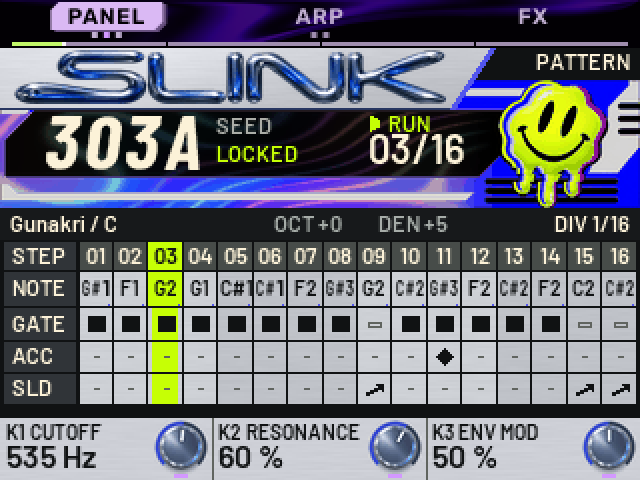
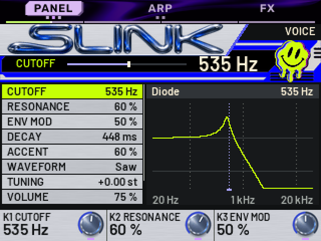

# Slink screen

On hdslaveOS 0.8.2, open **Stage → Panel**. Edit shows the host’s parameter list. The Edit captures below are from hdslaveOS 0.7.1.

Each new plug-in instance opens in **Press Plate**. To audition **Blacklight Transfer**, use Plus to reach **CLOCK**, turn the wheel to **THEME** and press the encoder. Another press switches back. The choice follows this instance across all five pages and between Edit and Stage for the session. Project and preset files contain the instrument settings only.

The freesp16 edition opens on the **Thorn Crown** Pattern page. The sequencer lettering pairs long beveled tips with curved bowls. Each note has a large pitch letter with the octave at its lower right. A sharp sits directly above the octave. Step numbers use fixed-width digits. The row labels and buttons share the same outlines. The native renderer draws the current score with coverage masks baked from the same letter outlines as the browser study. The crest uses a twenty-second baked camera move. The smiley and the narrow whip strip animate separately. [SP-16 controls](../README.md#freesp16-on-sp-16)

Build the offline browser study with `python3 tools/sp16_thorn/build.py` and open `build/slink-thorn-crown.html`. Its editable example runs on a silent local clock. The native plug-in displays the engine's generated pattern and auditions touched steps. [Source lettering](../tools/sp16_thorn/lettering.js) · [Native artwork baker](../tools/sp16_thorn/bake_native.py)

The blue-chrome Slink wordmark starts seven pixels from the left edge and spans 216 pixels of the brushed silver header on all five Press Plate pages. The lettering has three pixels of brushed silver above it and two below it before the dark edge. The brushed face grades from a soft upper-left highlight into a deeper silver at the lower right. The page name sits in the angled tab to its right. The lime melting smiley sits at the right end of the cobalt panel below. PATTERN uses the dark window for the four-digit seed, seed mode, transport and position. Turning the seed dial before publication shows PENDING and the seed of the score still on screen. In Notes mode the title bar reads “MIDI / SEQ MUTED”. Before the first pattern arrives the score displays “Awaiting clock”.

Each column of the punched-metal matrix shows one step's number, nearest note, gate, accent and outgoing slide. A filled rectangle opens the gate, a diamond marks an accent, and an arrow marks a slide. A small cobalt dot under a note indicates fractional-semitone CV. Zero CV is C2. The lime column follows playback. Patterns up to 16 steps use one bank. Longer patterns stack two banks so all 32 steps stay visible. The dark strip above the matrix lists scale, root, octave, density and clock division.

On all five Blacklight Transfer pages, the blue-chrome Slink title sits directly on the navy panel between the smiley ticket and the lavender page tab. A curved highlight and a reflected pink edge give the dripping lime face a jelly finish. The graph sits in a shallow recess, with shaded focus rows and pot rails below. PATTERN plots notes on a pitch roll. Filled notes indicate gates, hollow notes are rests, and pink connectors mark slides. VOICE and TONE place the filter trace above two columns of controls. [Blacklight Pattern in Stage](slink-mpc-blacklight.png) · [Smiley ticket](../assets/art/blacklight-pass.png)

On all five pages in both themes, two narrow slices through the smiley’s lower drips move sideways on a four-step downbeat or a gated accent. The offset grows from one native pixel to two, returns to one, and settles after 144 ms. Closely spaced hits share the current pulse. Stop clears it immediately. The motion uses Melodee’s display clock and the published sequencer position.

## Silver panel on MPC

<table>
  <tr><th>Pattern</th><th>Voice</th></tr>
  <tr>
    <td><a href="slink-mpc-pattern.png"></a></td>
    <td><a href="slink-mpc-voice.png"></a></td>
  </tr>
</table>

These images show Slink 0.6.3 in the hdslaveOS Stage host at twice the native resolution. A faint horizontal grain runs through the silver title plate, step cells, parameter rows and knob panels. On Pattern, K1–K3 control Cutoff, Resonance and Env Mod. On Voice, they follow the selected row and the two below it.

Voice and Tone give the filter plot more width and mark 1 kHz on its scale. Sequencer pairs the settings with a taller note display. Clock arranges its four settings in one row above a full-width score and swing indicator. [Clock in Stage](slink-mpc-clock.png)

## Controls

| Group | Rows or performance controls |
|---|---|
| PATTERN | K1 Cutoff, K2 Resonance, K3 Env Mod. Wheel changes Seed by one per detent, or sixteen with Shift. Turning locks a Random seed. Push presses Regen. Shift + Push presses Seed Back. Minus / Plus changes group. |
| VOICE | Cutoff, Resonance, Env Mod, Decay, Accent, Waveform, Tuning, Volume, Cutoff LFO Amount, Cutoff LFO Speed |
| TONE | Filter, Peak Spread, Drive, Slide, Slide Time, Accent Decay, Pitch LFO Amount, Pitch LFO Speed |
| TB-3PO | Mode, Seed Mode, Seed, Regen, Seed Back, Mutate, Density, Scale, Root, Octave, Steps, Gate, Transpose |
| CLOCK | Clock Div, Swing, Reset, Theme |

On a list the wheel moves one row per detent and stops at the ends. Push enters or leaves editing. On Regen and Seed Back it presses the button. On Theme it switches the display immediately. While editing, a detent moves a choice or integer by one, or a continuous value by 1/128 of its range. Shift gives 1/1024 for a continuous value. Minus / Plus moves an edited choice or integer by one and a continuous value by 1/16. Outside editing it jumps to the first row of the neighbouring group.

The pots turn the selected row and the two below it. Buttons, Theme and empty rows have no pot binding. Press Plate uses a satin-chrome dial with a cobalt arc, a white pointer and a track-colour mark below it. The face catches the light from the upper left as the pointer moves through 49 positions. Blacklight Transfer uses a track-coloured rail with a white pointer. A hollow square shows a known physical pot position waiting for pickup. Shift replaces the cards with the controls for the current page and edit state. Melodee owns pot takeover, its soft keys, and Shift + wheel when the host uses it to fine-edit the last touched pot.

VOICE and TONE plot the selected filter from 20 Hz to 20 kHz on a logarithmic axis. The vertical range is −36 to +24 dB. The curve uses the synth's response equations at the current settings, before envelope, accent, and LFO modulation. The dotted vertical marker and its foot show the frequency reported by Cutoff. Twin Peak marks its lower edge. SEQUENCER and CLOCK show the published seed and score. CLOCK divides each two-step interval at Swing, with a fixed halfway tick for reference. [Parameter descriptions](../README.md#controls)

## Art and previews

The approved master supplies the 320 × 64 PATTERN plate and the 320 × 42 editor plate. The asset generator extends a straight section of rail to fill the panel and preserves the smiley’s proportions at both heights. Both plates share an indexed palette. Both MPC themes use Barlow SemiBold for labels, note names and values, with eight levels of pixel coverage at native size. Each theme has its own size of bold italic Barlow Condensed seed numerals. [Master](../assets/explore/press-plate/master.png) · [Pattern plate](../assets/art/press-hero.png) · [Editor plate](../assets/art/press-editor.png) · [Credits](../THIRD_PARTY.md)

The contact sheet covers 20 fixture states, including a dense 32-step phrase, a pending seed in MIDI Notes mode, and the screen before the first clock. Each state has native RGB, nearest-neighbour 3×, RGB565 and a 320 × 240 Edit composite. The strip follows steps 4–7. The 2× GIF follows one complete cycle sampled every 30 ms, including the frames between steps. [Contact sheet](../assets/previews/contact-sheet-2x.png) · [Step strip](../assets/previews/step-advance-strip.png) · [16-step loop](../assets/previews/step-advance.gif)

From the checkout root, run the C++17 preview host on macOS. Rendering the gallery also uses Python with Pillow or the launcher's uv fallback.

```sh
tools/ui_preview/run --render
tools/ui_preview/run --render --blacklight
tools/ui_preview/run --test
tools/ui_preview/run --bench
```

In a Pillow environment, run `python3 tools/ui_preview/assets.py` for the original art and bitmap fonts, `python3 tools/ui_preview/press_type.py` for both MPC themes’ lettering and `python3 tools/ui_preview/silver.py` for its nameplate, brushed finish and dial frames. The default gallery is written to `assets/previews`. The optional Blacklight gallery is written to `build/ui-preview/blacklight-gallery`. Both test and bench commands exercise both themes. The PNGs and glyph arrays are committed. The gallery and test runner use the same screen class as the plug-in. The hash check reads the checked-in expectations. After an intentional visual change, `--hashes` prints candidate replacements for review.

For Linux use the running Colima profile, Docker context and builder image below. Start the profile with `colima start melodee` if needed.

```sh
./build.sh
docker --context colima-melodee run --rm --platform linux/arm64 \
    -v "$PWD:/work" -w /work -e CPU_FLAGS=-mcpu=cortex-a55 melodee-builder \
    sh -c 'tools/ui_preview/run --test && tools/ui_preview/run --bench'
tools/ui_preview/melodee
```

The last command runs the built plug-in through the sibling hdslaveOS checkout (`../melodee-hdslave-0.7.1`, version 0.7.1), mounted read-only. Set `MELODEE_SCREEN_TREE` to use a different path to that build. It captures the first six prescribed states, then exercises the two other filters and both sequencer lists.

| Capture | Live host state |
|---|---|
| [1](../assets/previews/melodee/1@2x.png), [2](../assets/previews/melodee/2@2x.png) | Edit opens on seed 3039 in Random. Two wheel detents dial 303B, lock it and leave 3039 on the score. |
| [3](../assets/previews/melodee/3@2x.png), [4](../assets/previews/melodee/4@2x.png) | These earlier captures show Cutoff moving from 535 Hz to 672 Hz. VOICE now opens on Cutoff. |
| [5](../assets/previews/melodee/5@2x.png), [6](../assets/previews/melodee/6@2x.png) | Shift shows the list legend. Releasing Shift and switching to Stage restores the cards under Stage's soft keys. |
| [7](../assets/previews/melodee/7@2x.png), [8](../assets/previews/melodee/8@2x.png) | TONE selects Twin Peak, then 18 dB. The trace, marker and value follow. |
| [9](../assets/previews/melodee/9@2x.png), [10](../assets/previews/melodee/10@2x.png) | TB-3PO and CLOCK each open on their first row and retain the published score. |
| [11](../assets/previews/melodee/11@2x.png), [12](../assets/previews/melodee/12@2x.png) | On CLOCK, select Theme and press the encoder. Blacklight Transfer appears immediately and all three pots are unbound on that row. |
| [13](../assets/previews/melodee/13@2x.png), [14](../assets/previews/melodee/14@2x.png) | Stage shows the Blacklight pattern. A second press on Theme restores Press Plate, with the same seed, voice settings and pattern knob bindings after returning to Edit. |

All fourteen host reports selected `screen=1`. [Host log](../assets/previews/melodee/host.txt)

## Bench and changed pixels

Measured for MPC Slink 0.6.3 on 2026-11-25. Each entry is the mean elapsed time for 2,000 calls to `update` plus `paint`. Event preparation and the pixel comparison used for reporting are outside the timer. The M4 Max runs native Apple Clang at `-O3`. The arm64 Colima VM runs GCC 12 at `-O3 -mcpu=cortex-a55` on the same Mac.

| Operation | Press Plate Mac, ms | Press Plate Linux, ms | Blacklight Mac, ms | Blacklight Linux, ms |
|---|---:|---:|---:|---:|
| Full PATTERN, 16 steps | 0.048744 | 0.054307 | 0.030283 | 0.034921 |
| Idle | 0.000029 | 0.000045 | 0.000023 | 0.000049 |
| Partial step, 16 steps | 0.035157 | 0.037156 | 0.022877 | 0.023487 |
| Full PATTERN, 32 steps | 0.052440 | 0.058177 | 0.034243 | 0.038455 |
| Partial step, 32 steps | 0.035570 | 0.037750 | 0.023444 | 0.024477 |
| Full VOICE, Twin Peak | 0.054167 | 0.064432 | 0.043960 | 0.048177 |
| Partial VOICE cursor move | 0.031175 | 0.033327 | 0.020038 | 0.021597 |
| Full VOICE while Resonance changes | 0.057872 | 0.071068 | 0.047573 | 0.054231 |
| Partial VOICE while Resonance changes | 0.055223 | 0.063012 | 0.042610 | 0.045340 |

Peak changed pixels per paint, counted across a full clock cycle or a traversal of every editor row. Both targets produced the same counts.

| Change | Press Plate | Blacklight Transfer |
|---|---:|---:|
| Idle | 0 | 0 |
| 16-step advance | 2,761 | 2,963 |
| 32-step advance | 1,774 | 1,953 |
| 16-step advance, Notes mode | 2,761 | 2,622 |
| TB-3PO miniature advance | 1,855 | 1,599 |
| CLOCK miniature advance | 1,865 | 1,253 |
| Dense microtonal 32-step advance | 1,761 | 1,977 |
| VOICE cursor | 7,314 | 10,257 |
| TONE cursor | 7,029 | 7,795 |
| SEQUENCER cursor | 7,646 | 9,310 |
| CLOCK cursor | 7,983 | 10,033 |
| Drip motion on PATTERN | 177 | 282 |
| Drip motion on VOICE | 71 | 282 |

Paint retains the last plug-in pixels independently of host overlays. Only invalidated regions are rendered. It compares their scanlines against the retained image before writing to the host. A whole paint covers all 320 × 218 pixels and respects the supplied stride.

The Linux ARM build passed 1,246,348 host checks, 512 sequencer reference checks and all 77 sound fingerprints. The two themes share a framebuffer and one set of input and playback state. The CLAP measures 461,408 bytes. Both targets passed 20 image hashes per theme, all sixteen hex digits in all four positions, controls, bindings, allocation checks, lengths 0–32, full/partial redraw comparisons and stride guards. The switch test checks independent instances, parameter edits, pot bindings, return to the default image and allocation counts. Motion checks exercise both themes, including ordinary gates, off-beat gated accents, intermediate offsets, settling and stopping mid-pulse.

## Engine handoff and hardware status

The existing Screen calls, Host, Edits, parameter IDs, PatternView and seqlock keep their contract. The supplied response functions and pattern fields cover this page. It needs no additional engine data. This screen revision builds on main’s existing clock and silent-instrument fixes.

Physical MPC testing is outstanding for the complete page, including on-device redraw time, SPI transfer time while playing, panel colour and readability, and the feel of encoder edits and pot pickup. The RGB565 previews, desktop timing runs and Melodee captures are the available checks.
