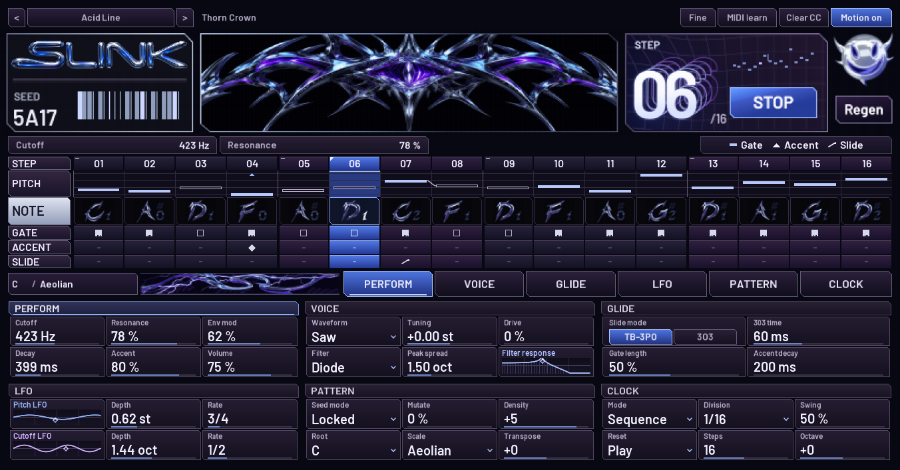

# hdslave Slink desktop CLAP plug-in

Separate desktop CLAP build of **hdslave Slink** for **FL Studio** (2024+) and any other CLAP host on macOS (Apple Silicon / Intel) and Windows (x64).



[View the 32-step pattern](assets/thorn-crown-desktop-32.png) · [Watch the editor during playback](assets/desktop-preview.gif) · [View the Windows editor under CrossOver](assets/windows-preview.png)

Slink **0.9.2** uses the freesp16 Thorn Crown faceplate. The chrome logo sits above the seed and barcode, the thorn camera fills the center, and the glass step counter shares its panel with the cobalt transport key. The turning smiley and **Regen** sit at the right edge. All 34 parameters fit in one resizable window, down to 960 × 540.

The pitch ribbon and chrome note keys line up with the Gate, Accent and Slide rows. One cobalt column follows the current step. Steps 17–32 appear alongside steps 1–16 when the pattern length exceeds 16. The key, scale and animated chrome whip sit below the score.

| Section | Controls |
| --- | --- |
| Perform | Cutoff, resonance, envelope modulation, decay, accent and volume |
| Voice | Waveform, tuning, drive, filter, peak spread and the filter-response XY pad |
| Glide | TB-3PO or 303 slide mode, 303 slide time, gate length and accent decay |
| LFO | Pitch and cutoff LFOs, each with its own XY pad, depth and rate |
| Pattern | Seed mode, mutation, density, root, scale and transposition |
| Clock | Sequence or Notes mode, clock division, swing, reset interval, step count and octave |

- **Edit steps.** Click or scrub numbered headers to audition. Drag a pitch vertically in semitones. Click a Gate, Accent or Slide cell to toggle it, or drag along its row to paint several steps. The first edit to a random pattern locks its displayed seed. The project saves those edits with that seed.
- **Select a bank.** Click a footer key to bring two editable readouts above the score. Touching a control in the lower banks also focuses its bank. The full score and all six banks stay visible. Click the root or scale at the left of the footer to change it. With a longer pattern stopped, click the step counter to jump between steps 1 and 17.
- **Play and recall.** Click **Play** to preview while the DAW is stopped. **Stop** ends the preview. The DAW takes over on transport start and the button reads **Sync**. Shift-click requests DAW transport in hosts that support it. Drag the barcode to set the seed, click **Regen** for a fresh pattern, or click the seed number to recall a previously played seed.
- **Shape the sound.** Drag across the filter plot for cutoff and up for resonance. Each LFO plot spans one beat. Drag across for rate and up for depth. Pitch depth reads in semitones and cutoff depth in octaves.
- **Use desktop controls.** Drag or scroll any value. Hold Shift or enable **Fine** for smaller adjustments. Click a choice to open its menu, double-click to reset, or right-click for reset and MIDI mapping. Left and Right select a step while stopped. Up and Down adjust the last touched parameter.
- **Control the artwork.** Click the crest to hold its camera, or Shift-click it to cut to the next angle. **Motion off** freezes the crest, smiley and footer animation while the counter and playhead follow the pattern.

The CLAP ID, parameter IDs and choice order, factory preset keys, MIDI note behavior, and desktop state envelope stay compatible with previous builds. Older projects load without manual step edits. A raw state from the freesp16 build can also carry the shared step-edit records.

Build from this checkout for the new editor. The [0.6.0 release](https://github.com/hdslave/hdslave-Slink-Synth/releases/tag/v0.6.0) contains the older desktop downloads. On upgrade, keep the installed filename if the host stores plug-ins by path. Install one copy per host.

## Build & Install (macOS)

Requires Xcode Command Line Tools and CMake 3.20+ (Ninja optional):

```bash
cd mac-clap
./build-macos.sh
./install-macos.sh
```

`install-macos.sh` builds, ad-hoc signs, tests, and installs `Slink.clap` to `/Library/Audio/Plug-Ins/CLAP/` (pass `--user` to install to `~/Library/Audio/Plug-Ins/CLAP/`). When upgrading an existing installation, the installer keeps the old bundle filename for project recall. Quit and reopen the host after installing.

## Build (Windows x64)

```powershell
cd mac-clap
.\build-windows.ps1
```

Copy `build\windows\clap\Release\Slink.clap` to `C:\Program Files\Common Files\CLAP\`.


## Shared artwork and validation

Both desktop targets embed the same Thorn Crown artwork bank as freesp16. The desktop editor draws the score, parameter sections and XY plots at the window’s device scale. Cocoa and Win32 present the same editor and send pointer events through the same hit targets. The step editor shares the hardware version’s audition and saved-edit logic.

Normal builds use the committed artwork. Rebuild the shared bank with `tools/sp16_thorn/bake_native.py` from the repository root. The desktop wordmark keeps the full resolution of the original lettering. To refresh it, run `python3 mac-clap/tools/bake_wordmark.py` with Pillow installed. Artwork and font credits are in [THIRD_PARTY.md](../THIRD_PARTY.md).

The desktop host test exercises all 34 parameter targets, editing at both ends of a 32-step score, project recall, MIDI learn, filter and LFO gestures, transport takeover, motion holds and native window resizing. Run `host_test --snap <directory> <plugin>` to capture the 16-step editor, the minimum window at Retina scale and a 32-step pattern. `--film <directory>` also captures four seconds of playback at 25 fps.
