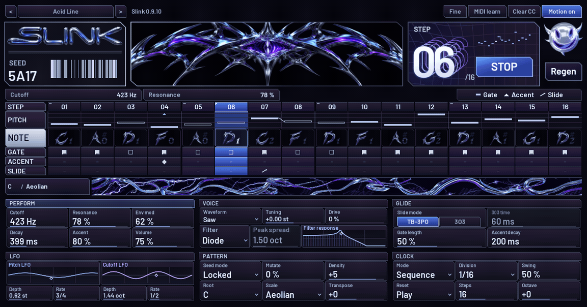

# hdslave Slink — macOS (and Windows) Desktop CLAP Plug-in

Separate desktop CLAP build of **hdslave Slink** for **FL Studio** (2024+) and any other CLAP host on macOS (Apple Silicon / Intel) and Windows (x64).



- **Multi-Screen MPC Dashboard:** displays all of hdslave Slink's native MPC screens simultaneously on one resizable Retina/HiDPI panel (with the hardware `K1`–`K3` footer panels removed) and direct mouse, trackpad, and touch control over every parameter, plot, sequencer, and pad.
- **Standalone from the MPC Sample build:** this directory is completely separate from the MPC Sample build in the repository root (`../src`, `../build.sh`). The [0.6.0 release](https://github.com/hdslave/hdslave-Slink-Synth/releases/tag/v0.6.0) lists platform downloads.

Slink 0.6.0 is the new name of TB-MPC-3-P-0. Existing projects use the same CLAP ID and factory preset keys. On upgrade, replace the previous plug-in in place, keeping its installed filename if the host stores paths. Install one copy per host.

Version 0.5.5 added a sine pitch LFO on **Tone** and a separate sine cutoff LFO at the bottom of **Voice**.
Both Speed controls follow the host BPM and snap to 1/1, 3/4, 1/2, and 1/3 beat per cycle. Tuning sits directly above Volume.

## Build & Install (macOS)

Requires Xcode Command Line Tools and CMake 3.20+ (Ninja optional):

```bash
cd mac-clap
./build-macos.sh
./install-macos.sh
```

`install-macos.sh` builds, ad-hoc signs, tests, and installs `Slink.clap` to `/Library/Audio/Plug-Ins/CLAP/` (pass `--user` to install to `~/Library/Audio/Plug-Ins/CLAP/`). When upgrading an existing installation, the installer keeps the old bundle filename for project recall. Quit and reopen the host after installing.

## Build (Windows x64)

```powershell
cd mac-clap
.\build-windows.ps1
```

Copy `build\windows\clap\Release\Slink.clap` to `C:\Program Files\Common Files\CLAP\`.
