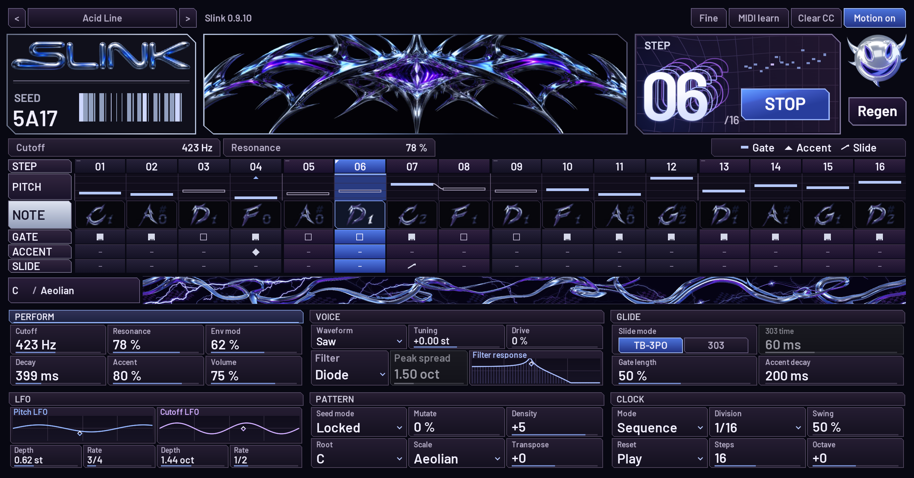

# hdslave Slink desktop CLAP plug-in

Separate desktop CLAP build of **hdslave Slink** for **FL Studio** (2024+) and any other CLAP host on macOS (Apple Silicon / Intel) and Windows (x64).



[Desktop 0.9.10 source and controls](https://github.com/hdslave/hdslave-Slink-Synth/tree/desktop-v0.9.10/mac-clap) · [Watch playback with audio](https://github.com/hdslave/hdslave-Slink-Synth/blob/667d967e53033010c330d335e746a84e3a3411a8/mac-clap/assets/slink-desktop-playback.mp4?raw=1) · [View all 32 steps](https://github.com/hdslave/hdslave-Slink-Synth/blob/667d967e53033010c330d335e746a84e3a3411a8/mac-clap/assets/thorn-crown-desktop-32.png) · [See the turning chrome smiley](https://github.com/hdslave/hdslave-Slink-Synth/blob/667d967e53033010c330d335e746a84e3a3411a8/mac-clap/assets/chrome-smiley.webp)

## Desktop 0.8.1 on main

[Earlier playback GIF](assets/desktop-preview.gif) · [Earlier Windows capture](assets/windows-preview.png)

This desktop copy is versioned 0.8.1 with the MPC build, but its engine is older than the MPC's. From 0.8.1 it has the clean filter after a long note. It lacks the MPC build's Mode: Notes fix for a note whose on and off come on one frame, as it lacks the step pads and the MPC build's handling of chokes (a choke here is a note off) and All Sound Off. Desktop hosts send note offs at their own frames, so such a note is rare there.

Slink 0.8.1 on macOS and Windows uses the SP-16 Razor Choir score. Each note has its own chrome letter with a separate sharp and octave. The plate beside the seed enlarges the current note. Click a step to inspect it there. Key and scale sit below the score beside the animated chrome whips, pitch contour and position rail. The counter offers **Play** and **Stop** in hosts that support CLAP transport requests. Other hosts show their transport state there.

All 34 host parameters fit on one resizable panel down to 960 × 540. In **Tone**, click **TB-3PO** or **303** to select the slide mode and drag **303 Time** to set the glide speed. The pitch and cutoff LFO pairs sit together below the filter settings. **Voice** groups Accent with Accent Decay. **Sequencer** puts Gate Length beside Octave and Transpose.

- Start playback in the host to advance the cobalt playhead. The chrome face turns on its own 4.8-second cycle. The lower strip loops two metal whips and forked lightning. Click a step to inspect it. New instances start with a locked seed. Click Regen to roll another seed and keep it for the next Play. Patterns longer than 16 steps have two banks and a **Follow** switch.
- Click the enamel **Regen** button for a new pattern. Drag the seed under the Slink wordmark to set a seed. Click **Key** or **Scale** to choose from a list.
- Drag or scroll a control to edit it. Hold Shift or enable **Fine** for small adjustments. Clicking a choice opens its menu. Double-click a control to reset it, or right-click for reset and MIDI mapping.
- Drag the filter response horizontally for cutoff and vertically for resonance. Drag across the score for transpose and vertically for density. These gestures send both parameters to the host for automation.
- Click the crest to jump to a different camera angle. Shift-click it to pause or resume the camera independently. **Motion off** holds the artwork while playback and parameter displays continue to update.

[Download Slink 0.9.10 for macOS and Windows](https://github.com/hdslave/hdslave-Slink-Synth/releases/tag/v0.9.10).

Slink 0.6.0 is the new name of TB-MPC-3-P-0. Existing projects use the same CLAP ID and factory preset keys. On upgrade, replace the previous plug-in in place, keeping its installed filename if the host stores paths. Install one copy per host.

The pitch and cutoff LFOs are separate sine modulators. Both speed controls follow the host BPM and snap to 1/1, 3/4, 1/2, and 1/3 beat per cycle.

## Build & Install (macOS)

Requires Xcode Command Line Tools and CMake 3.20+ (Ninja optional):

```bash
cd mac-clap
./build-macos.sh
./install-macos.sh
```

`install-macos.sh` builds, ad-hoc signs, tests, and installs `Slink.clap` to `/Library/Audio/Plug-Ins/CLAP/` (pass `--user` to install to `~/Library/Audio/Plug-Ins/CLAP/`). When upgrading an existing installation, the installer keeps the old bundle filename for project recall. Quit and reopen the host after installing.

## Build (Windows x64)

```powershell
cd mac-clap
.\build-windows.ps1
```

Copy `build\windows\clap\Release\Slink.clap` to `C:\Program Files\Common Files\CLAP\`.


## Desktop artwork

Both builds embed the same SP-16 artwork bank, including 600 crest frames, 240 whip-storm frames and 33 poses of the chrome Regen face. The crest and storm blend their 30 fps source frames at up to 60 Hz. The face blends adjacent poses independently. macOS 14 and later use the view’s display link. The score, filter curve and controls follow the instrument.

Normal builds use the committed bank. To repack the desktop artwork, run `mac-clap/tools/bake_razor.py` with the SP-16 checkout containing `assets/sp16-thorn/panel.bank` and `tools/sp16_thorn`, followed by a Chromium executable. The baker uses Python, Pillow and Playwright.

The interface uses Barlow SemiBold and Barlow Condensed Bold Italic under the SIL Open Font License. Artwork and font credits are in [THIRD_PARTY.md](../THIRD_PARTY.md). The embedded PNG and JPEG decoder is Sean Barrett’s stb_image 2.30 under the MIT license. [Source and license](third_party/stb/stb_image.h)
